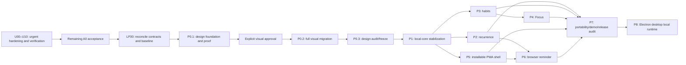

# Local-first Full Release implementation plan

This is the canonical dependency and delivery plan for the active release in `docs/SCOPE.md`.
Verification lives in `docs/QUALITY.md`. It replaces the completed/obsolete B0–B7 hackathon build
sequence; Git retains that history.

## Candidate-safety contract

- Urgent hardening U00–U10 takes priority over remaining A0 and P0–P8 work. It repairs existing
  commitments; it does not authorize later-roadmap features or broad restyling.
- The [architecture audit](research/ARCHITECTURE_AUDIT.md) records the inspected source, findings,
  and validation limits. Its dependency audit failed; the audited checkout is not a fully green
  release candidate. Preserve existing work and record the exact baseline before implementation.
- A package becomes a candidate only after its complete gate passes. Screenshots, elapsed time,
  or a partially working feature are not merge criteria. A focused repair passing its regression
  tests does not erase an unresolved full-gate failure.
- P0 visual proof requires explicit user approval. If approval is pending, agents may perform
  read-only audits or the specifically independent P1 diagnostic work; silence never authorizes the
  broad design rollout.
- Preserve the documented automatic unsigned-prerelease policy, but fail closed unless verification
  and platform gates cover the exact source and artifact bytes being published. Editing the workflow
  does not itself authorize a push or publication. Signed production distribution remains a separate
  gate under `docs/QUALITY.md` and `docs/DEPLOYMENT.md`.
- Historical hackathon dates belong in `docs/HACKATHON.md`; they are not current delivery deadlines.
  Never fall back to an unverified candidate merely to meet a date.

The urgent estimates below are planning ranges, not delivery promises. Re-estimate after U02 and the
U08 legacy-migration spike; native test-host access and signing/release prerequisites are separate
from engineering time. Existing P0–P8 estimates exclude urgent hardening and must be re-baselined
against implemented acceptance evidence before those packages resume.

## Release dependency graph

## U — Urgent architecture remediation

This is one hardening work package with sequential, reviewable checkpoints. Implement one checkpoint
at a time; use parallel agents for independent review only. Do not repeat already-proven behavior or
rewrite modules wholesale. Each patch includes its relevant regression, implementation, contract
updates, and focused verification; demonstrate the regression before fixing it, without committing a
deliberately failing test in isolation. U10 is the package sign-off, not a substitute for checks during
each checkpoint. All execution checkboxes below remain open until their evidence exists.

### Order, ownership, and finding coverage

| Order | Checkpoint / audit finding | Primary ownership | Dependencies | Engineering estimate |
|---|---|---|---|---|
| U00 | Protect baseline and repair early release guards / A08 | integration, CI/staging | none | 4–8 h |
| U01 | Nondestructive launch and retry / A01 | identity, task demo port | U00 | 4–8 h |
| U02 | Patch exposed dependency trees / A02 | integration, dependencies | U01 | 6–12 h |
| U03 | One transaction per coupled command / A04 | identity, companion, source modules | U02 | 6–10 h |
| U04 | Atomic 30 MiB memory cap / A07 | companion, identity reset | U03 | 6–10 h |
| U05 | Browser cookie renewal / A03 browser portion | identity | U01, U02 | 4–8 h |
| U06 | Shared AI admission limits / A06 | assistant | U02, U03 | 10–18 h |
| U07 | Desktop process ownership and failure handling / A09 | Electron runtime | U02 | 10–16 h |
| U08 | Authenticated desktop PostgreSQL, including upgrades / A05 | runtime, migrations | U07 | 16–32 h |
| U09 | Durable desktop identity / A03 desktop portion | identity, Electron main | U05, U08 | 12–24 h |
| U10 | Native verification and exact-artifact release gate / A08, final closure | integration | U00–U09 | 12–24 h |

Budget **90–170 engineering hours** before external waiting and unanticipated migration findings.
These are estimates, not measured throughput. U01 is the first product behavior fix. U00's local
guards do not wait for a Windows/Intel Mac test host. Native evidence can remain pending while
independent implementation proceeds, but its checkpoint/finding cannot be marked verified.

### Decisions and scope boundaries

- **Selected by the user:** repair desktop identity recovery and browser cookie renewal; defer
  browser recovery after expired/lost cookies. A username is never ownership proof. A03 closes only
  against these supported semantics, with the browser limitation retained in the release notes.
- Keep the modular monolith, PostgreSQL, existing provider adapters, and Electron runtime. No Redis,
  service extraction, sync engine, second database, or new dependency is presumed necessary.
- Normal startup resumes an authenticated actor; destructive demo reset and Reset app are explicit
  commands. Preserve existing first-create seeding until a separate scope decision changes it.
- Use required transaction ownership for coupled XP; use a per-user transaction advisory lock for
  memory mutations. Do not add a persisted memory-byte counter or a generic transaction framework.
- Use assistant-owned operational admission state, separate from identity's Better Auth limiter.
  Limits are abuse protection, not billing or a product quota tier.
- Keep DB credentials, desktop recovery capability, and the existing auth/encryption secret distinct.
  Preserve the existing `instance-secret` byte-for-byte during this work.
- Full encryption-key rotation, broad public-auth cleanup/CSP work (A17), read pagination/polling,
  ranking/export/bundle/image-size optimization (A10–A16), and wider test expansion stay separate.
  A18 regressions directly needed by A01–A09 are included here. No PostgreSQL major upgrade,
  product restore/import UI, auto-update, or broad design change is included.

### U00 — Protect the baseline and fail closed on release prerequisites

Files: `.github/workflows/ci.yml`, `.github/workflows/publish-desktop.yml`,
`scripts/stage-desktop-runtime.mjs`, owning script tests, setup/deployment/quality contracts.

- [ ] U00.1 Record the exact source SHA, dirty diff, lockfile, runtime manifest, toolchain, available
  native targets, and current failing gates in review evidence. Preserve the audit document and
  unrelated work; use disposable test databases/profiles with synthetic content.
- [ ] U00.2 Make desktop publication depend on canonical verification of the same immutable commit
  SHA. Retain main/master automatic unsigned-prerelease triggers and honest labels; a failed,
  cancelled, skipped, or missing required job must prevent publishing. Require the declared U10
  native acceptance evidence too: until those gates exist and pass for the same SHA/artifacts,
  publication stays blocked even if U02 makes the dependency audit green. Do not push or edit remote
  repository settings as part of this change.
- [ ] U00.3 Align the CI-built image with Compose's expected image, using one explicit tag/digest.
  Prove `--no-build` starts the newly built image on a clean runner with no cached fallback.
- [ ] U00.4 Repair staging containment with native relative-path semantics, preserving the guard
  before recursive deletion. Cover POSIX/Windows roots, normal descendants, sibling prefixes,
  traversal, drive/UNC changes, symlink/junction ancestors, and source/destination overlap.
  Verify committed archive checksums before extraction and fail on unexpected manifest mutation.
- [ ] U00.5 Run script tests and static workflow review. Carry clean-runner execution evidence into
  U10; a locally valid YAML file alone does not establish remote CI success.

Exit: the local release configuration fails closed, staging remains contained, and the image-name
defect is repaired. No claim that a prior executable is secure or that a remote workflow ran.

### U01 — Make ordinary bootstrap and retry nondestructive

Files: `modules/identity/{application,infrastructure,presentation}`, `app/api/v1/demo/route.ts`,
task demo composition, API/browser fixtures; `docs/modules/identity.md` and G1/G4 contracts.
No schema change expected.

- [ ] U01.1 Reproduce the existing-session GET failure → Retry deletion with a customized workspace.
  Assert task IDs/content, preferences, proposal, Companion state, and stored provider credential.
- [ ] U01.2 Separate authoritative ensure/resume from deliberate demo reset. Reuse a valid session
  even if localStorage has no username. A legacy empty-body `POST /api/v1/demo` must become a
  nondestructive compatibility path so cached/older clients cannot retain the deletion behavior.
- [ ] U01.3 Keep fresh-actor seeding and scoped explicit reset, migrate fixture callers to deliberate
  reset, and require clear intent/confirmation at any user-facing destructive action. The demo email
  suffix cannot distinguish disposable data: current personal profiles use it too.
- [ ] U01.4 Charge bootstrap allocation limits only when creating an actor, not when resuming one.
  Recover from missing/unreadable optional provider settings without blocking manual startup; keep
  the provider unavailable until repaired, without overwriting its stored key.
- [ ] U01.5 Prove retry after a lost response from an authenticated request (or a first response whose
  `Set-Cookie` was accepted before its body was lost), missing localStorage, port change with a
  valid cookie, and legacy `/demo` calls preserve the same actor/data. Losing the entire anonymous
  first response including its cookie provides no browser ownership proof; retain its data without
  promising same-actor recovery. Cover cross-user denial,
  explicit-reset atomicity, provider absence, and credential-decryption failure.

Exit: ordinary launch/retry cannot erase an authenticated workspace. Cookie-loss recovery is not
claimed by this checkpoint. Gate: focused unit/real-DB tests plus affected G1/G4, a11y/responsive
checks for changed flow, format/lint/type/boundaries, and route build.

### U02 — Patch dependencies and refresh the shipped inventory

Files: `package.json`, `pnpm-lock.yaml`, runtime manifest/Docker pins where affected, license checks,
`docs/STACK.md`; owning compatibility tests. No force-upgrade command or unreviewed override.

- [ ] U02.1 Refresh structured advisories and upstream release evidence; map direct/transitive paths
  in web, Docker, and desktop artifacts. Audit version numbers are historical minimums, not a fixed
  patch target. Distinguish a package match from demonstrated feature reachability.
- [ ] U02.2 Choose compatible patched direct versions first; align Next with `eslint-config-next`.
  Review Better Auth, Electron, and runtime compatibility. Use a narrow override only with a recorded
  upstream reason, compatibility proof, and removal condition.
- [ ] U02.3 Regenerate the lockfile; update stack/license inventory and the stale no-high/critical
  assertion. Inventory Electron, bundled Node/PostgreSQL, and image OS packages separately from npm.
  Keep PostgreSQL on its current major; follow U08 fixture protection before native runtime changes.
- [ ] U02.4 Verify frozen-lockfile clean installation, license/secret checks, production audit,
  `pnpm verify`, production Compose, and affected desktop build/runtime compatibility. If native
  evidence is unavailable, retain that explicit open gate instead of claiming A02 fully closed.

Exit: required high/critical audit gate passes and shipped runtimes have reviewed patch evidence.
Do not hide a failing audit with exclusions; any exception requires explicit policy review and
reachability evidence. Rollback means reverting the coherent package/lockfile/artifact change;
reintroducing a vulnerable dependency does not produce an acceptable release candidate.

### U03 — Remove nested pool acquisition from coupled transactions

Files: identity public preference/check-in composition, companion public/application contracts,
task/planner composition, `shared/db/client.ts`, and runtime-composition DB tests.
No table, dependency, pool-size increase, or standalone XP API expected.

- [ ] U03.1 Exercise the actual production public composition with a fixture pool of one. Current
  planner factory tests omit the Companion hooks; merely expanding that test's assertions cannot
  prove the production path. Use isolated real entrypoints, or one small factory shared by runtime
  and tests; do not build a second test-only composition or DI container.
- [ ] U03.2 Require a `DatabaseTransaction` for source-coupled XP. Extend the existing public identity
  preference reader with an explicit executor and forward it throughout; use the already computed
  authoritative local date for check-in. No browser-supplied XP dates or actor fields.
- [ ] U03.3 Preserve source idempotency, daily planner uniqueness, and aggregate versions. Prove
  task completion, Apply, and check-in succeed at pool size one; force XP/source failures in both
  directions and assert all source/ledger/profile writes roll back together.
- [ ] U03.4 Use deterministic barriers for more distinct-user commands than pool slots; cover
  midnight/timezone equality, retry, duplicate Apply, and cross-user denial. Include canonical
  preference rows in fixtures and retain the existing daily planner unique index.
- [ ] U03.5 Measure representative command/export/migration durations, then freeze finite connection
  acquisition, statement, lock, and idle-transaction deadlines in configuration/operations docs.
  Use driver/server cancellation semantics; do not return from `Promise.race` while SQL still runs.
  Apply appropriate operation-specific policies so export/migrations are not accidentally killed.
  Short test deadlines must prove rollback, released clients, and subsequent successful commands.

Exit: one command uses its owning transaction throughout; saturation and failure terminate without
partial data. Gate: real PostgreSQL runtime-composition/concurrency suite, boundaries, owning unit
tests, and affected G1/G3. Deadlines contain failures; they do not replace fixing the pool escape.

### U04 — Enforce the memory cap atomically and disclose eviction

Files: companion application/repository/public contract, identity reset coordination, narrow memory
feedback UI; module contracts and owning DB/browser tests. No persisted byte counter or migration.

- [ ] U04.1 Acquire a Companion-owned transaction advisory lock by authenticated actor and stable
  namespace. In the same transaction, sum SQL `octet_length(text)`, calculate incoming UTF-8 bytes,
  select only IDs/byte lengths in bounded oldest-first `(created_at,id)` batches, evict enough, insert,
  and return the actual committed eviction count. Preserve existing 500-character input semantics.
- [ ] U04.2 Make save, single-card removal, Companion deletion, and profile reset participate in the
  same guard. Identity uses a narrow public application coordination port and executor-aware account
  deletion. Acquire the guard before memory locks or account cascade; review concurrent XP/profile
  deletion for inverse ordering. Never deep-import lock SQL or serialize unrelated task commands.
- [ ] U04.3 Cover exact/over-limit ASCII/CJK/emoji saves, timestamp ties, multiple evictions, concurrent
  near-cap saves, rollback after eviction, separate-user independence, pool size one, and lock-timeout
  recovery. At least one real-DB case uses the actual 30 MiB limit. Exercise save versus remove,
  Companion deletion, and profile reset in both operation acquisition/interleaving orders while
  preserving one lock hierarchy; deleted accounts cannot be recreated. Include an already-over-cap
  fixture from the old race: the next successful save reconciles it under the same guard with
  disclosed eviction. Do not silently bulk-delete existing cards during deployment.
- [ ] U04.4 Show the returned positive eviction count with existing UI patterns; preserve the memory
  draft on failure and do not announce uncommitted success. Test browser feedback and authorization.

Exit: each successful save leaves memory at or below 30 MiB, including previously over-cap actors;
reset/delete races have defined atomic outcomes. Untouched pre-existing excess is not silently erased.
SQL aggregation still scans an actor's cards; this does not claim constant-time accounting or solve
A10 polling. Gate: real-DB races, affected G4/Companion paths, a11y and 1440/1024/390 checks; run
`pnpm verify:design` for shared presentation/token/target changes.

### U05 — Renew browser cookies without inventing recovery

Files: identity authentication gateway/configuration, response-capable session route/client path,
launcher copy where needed; identity/setup/security and G1/G4 contracts.

- [ ] U05.1 Inspect the patched Better Auth behavior and make session lifetime/update policy explicit.
  Implement an intentional response-capable refresh that forwards every required `Set-Cookie`.
  Prevent read-only Server Components from silently renewing only DB state. See
  [Better Auth's Next integration](https://better-auth.com/docs/integrations/next).
- [ ] U05.2 Preserve no-store responses, trusted-origin checks, cookie security attributes, server-side
  session validation, and protected-route denial. Use supported integration APIs rather than custom
  cookie signing. Add a throttled active-use/focus renewal trigger; a new endpoint or longer expiry
  without a caller is insufficient.
- [ ] U05.3 With controlled time, assert both actual browser-cookie and DB-session expiry advance,
  actor/data survive renewal and restart, and missing/forged/expired credentials cannot claim an
  existing actor. Keep a protected route continuously open beyond its original cookie expiry and
  prove active-use continuity. Verify the installed/upgraded integration, not only a mocked gateway.
- [ ] U05.4 State the browser limitation honestly: lost/expired cookies can leave retained workspace
  data inaccessible. New workspace creation must not imply recovery or delete the old records.
  Do not introduce recovery codes, email/password UI, or username-based ownership.

Exit: active-use browser renewal is proven. Browser recovery remains deferred. Gate: auth/DB tests,
actual browser G1/G4 and cookie inspection, changed-flow accessibility/responsive checks, route build.

### U06 — Bound all provider operations across actors and processes

Files: assistant-owned provider/admission application and infrastructure, all callers, validated
configuration; assistant/data/architecture/stack/quality contracts and generated migration if needed.

- [ ] U06.1 Inventory planner, check-in, Ameth chat, prompt analysis, and key verification; remove
  duplicate verification on key save. Freeze validated defaults and ceilings for deployment/actor
  request budgets, in-flight concurrency, input/output sizes, provider timeouts, and lease duration.
  Record units, retry behavior, operation weights if necessary, and how operators override them.
- [ ] U06.2 Use one assistant-owned execution/admission boundary with PostgreSQL-shared atomic
  buckets/leases. Follow the complete data-model gate before new typed tables: semantic search,
  ownership/invariants/dictionary, reviewed generated migration, fresh/upgrade/authorization tests.
  No generic JSONB, identity limiter reuse, Redis, background worker, or billing surface.
  Include forward-fix/rollback notes in the migration review before implementation.
- [ ] U06.3 Acquire admission in a short transaction and release its connection before HTTP. Enforce
  deadlines and expiring leases; release slots on every outcome. Never refund a dispatched request's
  budget merely because its response timed out. Deployment totals/active protections survive actor
  reset/deletion, process restart, and multiple app instances. Bound retention/cleanup of expired
  operational rows without deleting active protections or requiring a new scheduled service.
  Use database-authoritative time for windows/leases; the lease must outlast the enforced local
  request deadline plus cancellation/cleanup allowance. Preserve `maxRetries: 0` or explicitly
  account for every provider attempt. A paused process must revalidate before dispatch after expiry.
- [ ] U06.4 Reject with stable `RATE_LIMITED`/safe retry metadata and zero provider calls; do not queue
  unbounded work. Admission-store failure disables provider calls, while manual workflows remain
  usable. Persist opaque operational metadata only; keep prompts, responses, keys, and raw chat out.
- [ ] U06.5 Prove all five paths, account/server keys, multi-actor/multi-instance contention, actor
  churn, boundary rollover, cancellation, timeout, crash/lease expiry, and store failure. Assert
  `store:false`, bounded input/output, redaction, no leaked DB connection, and no unauthorized domain
  writes. Include a slow call at the lease boundary and process pause → expiry → resume. Use a
  deterministic provider fixture; live paid calls are not required.

Exit: configured aggregate call/local-attempt concurrency ceilings cannot be bypassed through actor
rotation or another app process. Upstream work may outlive local cancellation; these controls do not
promise an exact RM spending cap or absolute remote concurrency. Gate: policy/unit and
real-DB contention/migration tests, provider-degraded G3/Companion/Prompt paths, route/env build.

### U07 — Own desktop processes from acquisition through shutdown

Files: `electron/main.ts`, `electron/runtime.ts`, `electron/runtime-process.ts`, small responsibility-
specific runtime modules and deterministic process tests; architecture/setup/runtime contracts.

- [ ] U07.1 Create one runtime owner before spawning: `starting`, `ready`, `degraded`, `stopping`,
  `failed`; own abort, registered children, readiness, and an idempotent cleanup promise. Put secret
  preparation and all resource acquisition under cleanup. Quit must cancel/wait during startup too.
- [ ] U07.2 Attach lifetime error/exit listeners immediately. Bound every command and captured output;
  settle once, retain redacted phase/error diagnostics, and stop work promptly on cancellation.
  Use only bounded retries for identified transient bind collisions; port probing is not reservation.
- [ ] U07.3 Minimize inherited environments by child purpose. Keep bootstrap/migration credentials
  out of the regular Next child; never pass a durable recovery bearer through child arguments/env.
  Stop application work, Next, then PostgreSQL with bounded `pg_ctl` and confirmed exit. Escalate
  only against owned processes; prove Windows tree handling and no orphan on signal exit.
- [ ] U07.4 On a post-readiness child failure, leave ready immediately, clean up dependents, and offer
  a minimal native retry/recovery action. No automatic restart loop after migration, corruption,
  permission, or disk failures. Preserve data/secrets and retry only after cleanup completes.
- [ ] U07.5 Inject failure/quit at each startup phase, duplicate stop, hung command, spawn/signal
  errors, output overflow, failed termination, occupied ports, and post-ready child death. Packaged
  native evidence must cover process exit and preserved fixture data, not just mocked handles.

Exit: failures terminate or enter an explicit bounded recovery state without losing ownership of
children. Gate: deterministic lifecycle tests and native failure/shutdown checks for each target.
Any web recovery UI added later needs its routed screen/accessibility contract.

### U08 — Replace desktop trust authentication without losing existing data

Files: Electron storage/runtime provisioning, migration runner configuration, platform checks and
native fixtures; setup/security/architecture/quality contracts. This is a role/authentication change,
not a PostgreSQL major-version or product data-schema redesign.

- [ ] U08.1 Before changing an installed fixture, stop it and rehearse complete application-data
  backup/restore with its matching prior executable: entire cluster, original `instance-secret`,
  session/profile evidence, and later new credential files. Include synthetic tasks, Companion data,
  and an encrypted fake key. JSON export alone is not rollback. Never run the old binary against a
  partially migrated cluster. Reuse this protection before any U02 native runtime patch.
  This fixture prerequisite is independently executable before U02: it does not depend on U07 or
  completion of U08. Missing native access leaves that target's runtime patch/evidence pending,
  not U01 or unrelated web fixes.
- [ ] U08.2 Enforce owner-only existing/new data and secret paths: macOS ownership/modes and Windows
  owner-SID/DACLs, including symlink/junction/inherited-permission checks. Fail safely on unsupported
  protection. Generate separate DB credentials; never rotate the existing instance secret here.
- [ ] U08.3 For fresh clusters, use unique protected credentials, SCRAM, and a protected initdb password
  file. Remove all applicable trust fallbacks, including local/replication rules. No secret in command
  arguments, logs, renderer, or package. Audit administrative extension provisioning separately.
- [ ] U08.4 Separate bootstrap administration, schema-owning migration login without superuser, and
  runtime schema-usage/DML/sequence privileges. Review current/future-table grants against actual
  Better Auth and migrations; runtime cannot create databases/roles, elevate, or run schema migrations.
  Transfer legacy application schema/table/sequence and migration-journal ownership to the migrator
  in a reviewed scope; grants alone do not permit ALTER on old objects. Review extension ownership
  separately, prove a subsequent upgrade migration, and deny runtime `SET ROLE` to elevated roles.
- [ ] U08.5 Spike a stopped-cluster legacy transition on Windows and macOS before selecting its
  implementation. PostgreSQL single-user provisioning is a candidate, not a proven cross-platform
  recipe. Require exclusive ownership and a protected backup; do not reopen a TCP trust listener
  merely to change credentials. If the spike fails, design/review another secured transition before
  migration coding. See [PostgreSQL single-user mode](https://www.postgresql.org/docs/17/app-postgres.html)
  and [SCRAM authentication](https://www.postgresql.org/docs/17/auth-password.html).
- [ ] U08.6 Use an atomic versioned journal with durable checkpoints: credentials saved, roles
  provisioned, authentication installed, authenticated login verified, normal startup enabled.
  Journal stores no duplicate secrets. Interrupt at every durable write; resume with the same
  credentials and never fall back to trust, reinitialize, or delete ambiguous data.
- [ ] U08.7 Prove fresh and legacy upgrades, wrong/empty-password denial, second-OS-user file and DB
  denial, runtime privilege denial, offline migrations, restart and full restore. Preserve actor/task
  IDs, data, and encrypted-key readability. Lost credentials, unknown major, corrupt journal, or ACL
  failure must preserve the directory and explain operational recovery without guessing ownership.

Exit: fresh and existing supported installations require authenticated least-privilege access.
macOS mode checks are not Windows ACL evidence. Gate: native authentication, interruption, process,
upgrade, and restore matrix; inspect arguments/logs/artifacts for secret exposure.

### U09 — Recover the same desktop actor using OS-protected proof

Files: identity application/authentication boundary and possible typed binding schema, Electron main
storage/session integration; identity/data/architecture/setup/quality contracts.

- [ ] U09.1 Freeze the enrollment/recovery protocol before coding. Prefer Electron OS-backed secret
  storage plus protected files/ACLs; fail closed if protection is unavailable, with no plaintext
  fallback. Verify APIs against the pinned Electron version. Account for OS-user/device binding in
  restore instructions. [Electron safeStorage](https://www.electronjs.org/docs/latest/api/safe-storage)
  is a storage primitive, not an authorization or same-user malware boundary.
- [ ] U09.2 Generate a capability distinct from DB/auth/provider secrets. Identity owns authenticated
  enrollment, actor binding, proof validation, session issuance, and revocation. If a binding table
  is necessary, store only verifier/hash material and complete the schema/migration gate first.
  Review forward-fix/rollback behavior before adding the binding migration.
  Electron uses a narrow main-to-server channel; no feature/database imports in Electron.
- [ ] U09.3 Protect initial enrollment as well as recovery against arbitrary local/browser clients:
  valid actor session plus installation-specific main-process proof. Loopback/Origin headers alone
  are not proof. Scope the trusted channel to the owned server/startup, make enrollment idempotent,
  and review replay/concurrent-enrollment rules. No capability in renderer/preload, URLs, logs,
  arguments, ordinary responses, or export; main sets returned cookies through Electron's session.
- [ ] U09.4 Enroll a fresh actor or a legacy actor with a valid session. If an old installation has
  neither a valid session nor an enrolled capability, preserve its data and report recovery
  unavailable. Never choose the first/only actor, username, or demo suffix. Reset revokes the binding;
  stale local proof cannot resurrect deleted data or bypass current authorization.
- [ ] U09.5 Verify same actor/data after expiry, cleared Electron cookies, changed port, restart, and
  upgrade; reject forged/foreign/revoked proof. Cover missing/corrupt/read-only secret storage,
  interrupted enrollment, duplicate recovery, reset races, and cancellation during shutdown. A
  request without trusted main-process proof cannot enroll or recover an existing desktop actor.

Exit: supported desktop recovery works on Windows and macOS; the browser limitation and legacy
unenrolled limitation remain explicit. Gate: auth/DB/migration tests, packaged native cookie/data
survival and reset/hostile-client tests. Do not claim general account recovery or cross-device sync.

### U10 — Verify the integrated candidate and publish only tested artifacts

Files: verification/publication workflows, runtime staging/package audit and smoke scripts,
release metadata; quality/setup/deployment/stack contracts and finding acceptance evidence.

- [ ] U10.1 Run `pnpm verify` on the exact candidate, plus clean/upgrade migrations and clean-runner
  production Compose health, worker, signal, and provider-absent checks. Refresh the dependency and
  runtime audit after all changes. Repair any required failure before package sign-off.
- [ ] U10.2 Replace obsolete email-signup runtime smoke with the real profile path: bootstrap, create
  a task, restart, expire/clear desktop cookies, recover the same actor, and verify saved data. Move
  all fixtures before narrowing any obsolete public auth endpoints in a later A17 change.
- [ ] U10.3 Verify macOS arm64, macOS x64, and Windows x64 separately: package contents/checksums,
  headless runtime smoke, interactive G10, offline/no-provider operation, legacy upgrade/restore,
  and lifecycle/authentication faults. Record unsigned test status separately from stable
  signing/notarization. Missing hosts/signing credentials leave corresponding release gates open.
- [ ] U10.4 Join verification, native build/test, and publication by one immutable SHA. Publish the
  exact tested artifacts without rebuilding; attach SHA, app/runtime versions, platform, checksums,
  and gate evidence. A failed/missing required target must block the declared release set. Retain
  authorized automatic prerelease policy; production distribution still requires its signing gate.
- [ ] U10.5 Self-review the complete diff for scope, boundaries, schema, authorization, secret/data
  exposure, dead code, migration rollback, and retained limitations. Map each A01–A09 finding to its
  passing regression and operational evidence. Update acceptance checkboxes in place; do not append
  a session diary. Keep reports/results with the candidate review artifacts, excluding user data.

Exit: only proven findings are closed. Report source, exact commands/results, native targets,
remaining limitations, and whether this is local verification, CI artifact readiness, unsigned
prerelease readiness, or signed distribution. No remote push/deployment/publication is performed
merely because local checks pass.

### Plan review and execution gates

Security, data-integrity, and runtime/dependency reviews found no remaining planning blocker after
the resolutions below. This is a review of task completeness, not implementation or release proof.

| Review concern | Required resolution in this plan |
|---|---|
| Existing clients can still erase data | U01 changes the legacy endpoint's ordinary behavior, not only the new launcher. |
| Session renewal mistaken for account recovery | U05 proves cookie + DB renewal; U09 requires durable proof; browser recovery is explicitly deferred. |
| Tests bypass the faulty production composition | U03 tests actual public runtime wiring with a one-connection pool. |
| Quota race survives delete/reset | U04 coordinates every memory-set mutation under one lock order. |
| New actors bypass AI limits | U06 deployment-wide state survives actor rotation and spans app processes. |
| Fresh-install hardening leaves old clusters vulnerable | U08 includes stopped-cluster transition, interruption, restore, and each OS permission model. |
| Desktop recovery trusts arbitrary localhost callers | U09 requires installation-specific enrollment proof and keeps the bearer out of renderer/process metadata. |
| Packaging success mistaken for release verification | U00/U10 bind canonical and native evidence to one SHA and tested artifact bytes. |
| Deadline pressure relaxes acceptance | No skipped required check closes the package; historical dates confer no exception. |

The remaining technical choices are bounded implementation gates, not missing product authorization:
U02 patched versions; U03 measured timeout values; U06 explicit admission defaults/table design;
U08 proven legacy transition and ACL implementation; U09 exact protected enrollment protocol/schema.
Resolve each with code/primary-source evidence before its dependent mutation. If a solution would
require a new product capability or cut an existing commitment, apply the scope-change protocol.

The common checkpoint gate is format/lint/type/boundaries, changed unit behavior, real-DB persistence
and authorization evidence, and applicable browser/build/native checks listed above. Flow/UI changes
also require a11y and 1440/1024/390 review; shared presentation changes require `pnpm verify:design`.
Run `pnpm verify` for every package candidate and final closure. A pre-existing failure is reported
as a failure, not waived; it can leave a focused patch ready for integration while U remains open.

## A0 — Ameth Companion (user-authorized priority package)

After U closes and before resuming P0–P8, finish the remaining `modules/companion` acceptance for its profile/XP/summary migration,
authenticated API contracts, private export integration, and global responsive presentation surface.
The package awards deterministic XP from source-module transactions; it never gates a manual workflow,
persists raw chat, or bypasses the planner review/apply boundary. Avatar assets are supplied at
`public/ameth/level-{1,2,3}.webp`; a token-backed fallback is required until those assets exist.

Gate: migration/ownership/idempotency tests; provider-absent/no-mutation chat tests; shell keyboard,
touch, reduced-motion, and responsive evidence; export/privacy checks; `pnpm verify`.

P2, P3, and P5 may run in parallel only after P1 freezes their public contracts. P4 may begin pure
domain work after the Habits ownership-validator contract freezes. P6 waits for recurrence and the
service-worker contract. Each P2-P6 package supplies and integrates its portable representation;
the integration owner serializes export-schema version bumps as packages land. P7 owns the final
cross-version audit, demo, documentation, and cross-module evidence, not the first export integration.

## Parallel execution contract

Parallel work is split by capability/layer ownership, never merely by route.

### Integration-owner files

Only the integration owner edits or serializes:

- canonical scope/goal/plan/architecture/quality documents;
- `package.json`, `pnpm-lock.yaml`, shared environment configuration, and license allowlists;
- shared design tokens until P0 foundation freeze, root shell/navigation, and root route maps;
- global Drizzle schema aggregation and generated `drizzle/*` migrations;
- worker composition, export schema version, demo reset composition, Docker/CI/release configuration;
- full database, browser, service-worker, worker, Docker, and `pnpm verify` gates.

### Worker rules

- Each lane starts from the same green checkpoint in an isolated worktree/thread and owns an explicit
  non-overlapping file list.
- Pure domain/application/test work may run before a serialized migration only when the public
  contract is frozen and no dormant production export is exposed.
- A lane returns a coherent commit plus exact focused checks. The integration owner audits scope,
  boundaries, schema, ownership, security, and dead code before integration.
- No worker silently edits shared tokens, dependency files, global schemas, migrations, route maps,
  or canonical contracts.
- Browser/Docker/database/full gates run centrally and sequentially to avoid shared-state and machine
  resource conflicts.

## LF00 — Reconcile contracts and verify the baseline (2–4 hours, serial)

### Boundary

Planning and current-truth repair only. Do not add product code, dependency, route, table, or control.

### Deliverables

- Apply the five-part user-authorized scope change across `AGENTS.md`, scope, goal, plan,
  architecture, stack, data, module, design, quality, setup, and manifest contracts.
- Promote only P0–P8. Keep Stage A–D explicit and non-active.
- Define local/self-host completion and remove hosted deployment as a goal prerequisite without
  deleting optional deployment guidance.
- Preserve the exact baseline without assuming it is green and confirm repository,
  Node/pnpm, PostgreSQL, migrations, demo entry, and provider-absent baseline.
- Inventory exact tables/routes/dependencies before later schema changes.

### Gate

- No contradictory active/deferred/zero-job/hosted-prerequisite wording in current-truth docs.
- Documentation links and manifest routing resolve; no status diary was added.
- `pnpm format:check`, `pnpm lint`, `pnpm typecheck`, `pnpm check:design`, and existing focused core
  tests pass; run `pnpm verify` when PostgreSQL/browser prerequisites are available.
- No P0–P8 production implementation appears in the LF00 diff.

## P0 — Editorial Focus visual-system migration (24–40 serial hours; 14–22 elapsed)

### Boundary

Presentation/design only for the already-working core. Preserve every route, workflow, state,
authorization rule, API, data model, module boundary, and information architecture. Follow the
pinned research source through the application contract in `docs/design/editorial-focus.md`.

### P0.1 — Foundation and five-screen proof (8–12 hours; then stop)

Deliverables:

- Capture the current App launch, Today, Calendar, task-detail, and populated AI Review baselines before
  changing executable tokens.
- Finalize original light/dark semantic tokens, contrast pairs, type scale, density, radii,
  elevation, focus, and motion in docs, CSS, and computed design tests together.
- Self-host the GetDesign-recommended, reviewed OFL-licensed EB Garamond Variable substitute for
  display moments and Inter Variable for working UI through `next/font/local`; use only the font's
  genuine 400–800 axis, commit font licenses, and add no font runtime dependency.
- Update shared tokens/primitives first. Target task titles near 15/22 px and comfortable two-line
  rows near 64 px while preserving 36 px fine-pointer controls and 44 px touch targets.
- Implement only the five real proof surfaces with deterministic demo/fixture data. Keep serif and
  atmosphere out of dense task/calendar/form content.
- Capture 1440 and 390 light proofs, representative dark proofs, and 768/320 boundary evidence. AI
  Review mobile evidence must show both populated proposal content and sticky Apply controls.
- Present current/new comparison evidence and stop for explicit user approval.

Gate:

- `pnpm check:design`, focused proof component tests, `pnpm verify:design`, affected Playwright proof
  and fixture paths, `pnpm test:a11y`, `pnpm verify:quick`, and `pnpm build`.
- Manual contrast, keyboard, route-focus, reduced-motion, 200% zoom, font-load determinism, and
  responsive overflow review.
- Diff proves no behavior/API/schema/route change and no copied branding, asset, copy, palette,
  layout, audio motif, proprietary font, or trade dress.
- **Explicit user screenshot approval.** P0.2 cannot start without it.

### P0.2 — Approved full-screen migration (12–20 serial hours)

After the shared foundation freezes, run three non-overlapping presentation lanes:

1. Direct app launch, local profile setup, Settings, loading/offline surfaces, and responsive shell.
2. Task navigation, rows, quick add, details, editors, overlays, dialogs, and every task state.
3. Today/Upcoming, Calendar, Matrix, and planner Describe/Processing/Review/Result states.

Each lane preserves behavior tests and covers light/dark/system plus default, empty, loading, error,
offline, permission, provider, and conflict states. No lane changes shared tokens without
integration-owner review.

### P0.3 — Integration audit and design freeze (4–8 hours)

- Inspect every route at 1440, 1024, 768, 390, and 320 CSS px, plus coarse pointer, reduced motion,
  200% zoom, keyboard-only paths, focus entry/return, and light/dark/system themes.
- Run `pnpm verify:design`, affected G1–G4 paths, `pnpm test:a11y`, `pnpm build`, then `pnpm verify`.
- Audit that task text is measurably less cramped, operational density remains usable, and no mixed
  old/new component hierarchy remains.
- Obtain final migrated screenshot approval before feature UI starts.

## P1 — Local-core stabilization (10–16 serial hours; 7–10 elapsed)

### Boundary

Close audited gaps in existing behavior only. No recurrence, habit, Focus, PWA, reminder, or later
schema/control may appear.

### Deliverables

- Context-aware quick add defaults exactly to current Inbox/current regular list unscheduled, Today
  all-day today, or Upcoming all-day on the next local day. A visible editable recognized date/time
  may override the default; Calendar uses the full create/schedule form and Matrix uses only the
  global palette.
- One atomic create-with-schedule application use case and endpoint; no orphan task on schedule
  validation/conflict/network failure.
- Canonical authorized task inspector/detail access from Today, Upcoming, Calendar, Matrix, search,
  and planner result contexts.
- Correct query invalidation after task/schedule/planner apply and local-midnight/timezone refresh for
  Today/Upcoming/Matrix without full browser restart.
- Restore planner Review/Result from persisted proposal state after refresh/navigation; never infer
  a proposal from client-only state.
- Show accurate optional OpenAI capability in Settings and retain clear no-key/manual paths.
- Harden supported local origin/CSRF configuration and document both `127.0.0.1` and `localhost`
  without wildcard trust.
- Repair stale local feature/setup claims and preserve user input across offline/error/conflict paths.

### Gate

- Focused domain/application/component/API/database tests for atomicity, ownership, idempotency,
  stale versions, midnight/system-timezone changes, query freshness, and origin policy.
- G1–G4 and forced variants at desktop/mobile, no-key workflow, affected a11y/design checks.
- `pnpm verify`; no extension table/dependency/route/control exists.

## P2 — Bounded schedule-based recurrence (24–36 serial hours; 14–20 elapsed)

### Boundary

`modules/tasks` owns rules/events and task mutations; `modules/planning` consumes bounded public
occurrence projections. No generated task clones, second status/schedule fact, reminder behavior, or
AI-created recurrence.

### Deliverables

- Promote reviewed `rrule` dependency, domain wrapper, canonical presets, and safety caps.
- Add `task_recurrences` and `task_occurrence_events` through one reviewed migration with tenant-
  leading ownership, checked date/instant cutovers, immutable post-command `task_version` ordering,
  constraints, indexes, upgrade tests, and no generic JSON.
- One schedule-anchored rule for an eligible scheduled root task: daily, weekdays, weekly selected
  weekdays, monthly day-of-month, or yearly month/day, bounded interval, and never/until/count end.
- Store a checked all-day/date or timed/instant projection cutover on the single mutable rule. Initial
  projection begins at the schedule anchor; rule/schedule edits choose a server-controlled future
  cutover, preserve recorded earlier events, and do not claim to reconstruct unrecorded pre-cutover
  occurrences.
- Deterministic `occurrence_key`, range-bounded all-day/timed expansion, DST/month/year behavior, and
  projection into Today, Upcoming, Calendar, agenda, and Matrix.
- Complete, skip, and undo/reopen one occurrence without completing the series; edit/end future
  expansion while preserving past occurrence events.
- Task-detail/row occurrence labels and accessible series/occurrence actions; planner treats bounded
  recurring busy intervals as context but cannot create/edit recurrence.
- Recurrence demo fixture plus an integrated, version-bumped portable recurrence/event section before
  the P2 gate; the integration owner serializes the shared export schema.
- Before migration generation, freeze exact preset interval/count/computation bounds and the missing-
  month-day/leap-day policy in the task/domain/data contracts. No migration or UI may invent a bound
  independently.

### Explicit exclusions

Completion-relative rules, raw RRULE entry, individual occurrence reschedule/content edit, “this and
future” forks, exclusion-date editor, recurring checklist/subtask state, and arbitrary custom
cadence remain Stage A.

### Gate

- Preset/Zod/domain/DB constraint, ownership, optimistic conflict, and concurrency tests.
- Deterministic cap/range/occurrence-key, DST gap/fold, month-end, leap-day, edit/end, complete/skip/
  undo, and no-duplicate fixtures.
- Desktop/mobile recurrence golden path, keyboard schedule parity, responsive/a11y/design evidence.
- Empty and upgrade migration, query-plan/index review, `pnpm verify`.

## P3 — Habits (22–34 serial hours; 13–19 elapsed)

### Boundary

`modules/habits` owns definitions, schedules, local-day logs, and derived projections. No task,
Focus, reminder, social, achievement, or health behavior is hidden inside it.

### Deliverables

- Promote `habits`, `habit_schedules`, and `habit_logs` through one reviewed migration and narrow
  public application contracts.
- Create/edit/archive/restore boolean or numeric habits with daily, selected-weekday, or target-per-
  week schedules in an IANA timezone.
- Today check-in, quantity/note edit, undo, skip, and unachieved with one effective log per local day.
- Freeze ISO Monday-Sunday weekly-target behavior: show every in-range day until achieved; count each
  successful day once; keep a below-target current week in progress; fail it only after Sunday;
  preserve edit/undo after achievement without presenting more required work.
- Derived current/best streaks, seven-day strip, and compact monthly heat-map data; never store
  counters.
- Responsive Habits list/detail/create UI and Today integration with default, empty, loading, error,
  offline, permission, and conflict states.
- Integrated, version-bumped portable habit section and deterministic demo fixture before the P3
  gate; the integration owner serializes the shared export schema.
- Before migration generation, freeze exact title/icon/unit/note/value/quantity/weekly-target bounds
  in the module and data contracts so Zod, domain, PostgreSQL, and form copy share one definition.

### Gate

- Goal/schedule discriminant and DB constraints; cross-user and same-day concurrent-write denial.
- Daily/weekday/weekly-target, DST/week-boundary, quantity, edit/undo/skip/unachieved, archive/restore,
  Today, streak, and heat-map fixtures.
- Desktop/mobile Habits golden path; keyboard/screen-reader heat-map, responsive/design/a11y checks.
- Empty and upgrade migration, `pnpm verify`.

## P4 — Focus (18–26 serial hours; 11–15 elapsed)

### Boundary

`modules/focus` owns authoritative timer/session state and derived totals. It consumes narrow task and
habit ownership/link validators only. Client ticks never own persisted time.

### Deliverables

- Promote `focus_sessions` with checked `kind=focus|break` through one reviewed migration and a
  partial unique one-active-session invariant across both kinds.
- Pomodoro/stopwatch focus and explicit break start/pause/resume/finish/discard. Focus rows may link
  to one owned task or habit; break rows link to neither and never contribute to focus totals.
- Reconstruct active state from server timestamps/accumulated seconds after refresh/reconnect;
  Pomodoro breaks never contribute to stored focus time.
- Correct/delete completed sessions, today/seven-day totals, and recent history.
- Responsive Focus route with idle/running/paused/break/reconnect/loading/error/offline/permission/
  conflict states and screen-reader announcements only at meaningful transitions.
- Integrated, version-bumped portable completed-focus section (excluding break rows) and deterministic
  demo fixture before the P4 gate; the integration owner serializes the shared export schema.
- Before migration generation, freeze focus/break/correction/duration limits in the module and data
  contracts; client timer defaults cannot become database policy by accident.

### Gate

- Pure state-machine/idempotency tests with injected clock; hostile-clock/reconnect fixtures.
- DB race proving one active/paused session and cross-user task/habit/session denial.
- Pause accumulation, finish/discard, break exclusion, correction/deletion, summary-window, and
  historical-link tests.
- Desktop/mobile Focus golden path, reduced motion, tabular numeral, a11y/design checks.
- Empty and upgrade migration, `pnpm verify`.

## P5 — Installable PWA shell with honest offline fallback (10–16 serial hours)

### Boundary

Installability and static shell resilience only. Do not persist authenticated API/user content in
Cache Storage, add IndexedDB domain data, accept offline writes, register background sync, or imply
offline-first behavior.

### Deliverables

- Original maskable/standard icons, manifest metadata, standalone display, scope/start URL, theme
  metadata, and install guidance where supported.
- A small versioned service worker caching only fingerprinted public/static assets and a dedicated
  content-free offline fallback; explicit activate/update/reload and old-cache cleanup behavior.
- Preserve already rendered content read-only when connectivity drops, disable all domain writes,
  and recover cleanly online.
- Clear capability/error/update UI and service-worker registration isolated behind a presentation
  adapter; no second UI framework or speculative native layer.
- Serialize the P5 export-schema version step through the integration owner while deliberately adding
  no PWA/device/cache data section; add a regression test proving those operational details are not
  portable.

### Gate

- Manifest/icon/scope/installability audit; cold offline fallback and online recovery.
- Cache inventory proves no authenticated HTML/API, task/planner/export, provider, mutation, or
  secret-bearing response is stored.
- Upgrade/old-cache cleanup and corrupted/missing-cache recovery tests.
- Standalone desktop/mobile responsive/a11y/offline-write-denial paths and `pnpm verify`.

## P6 — One browser-push task reminder and active worker (24–36 serial hours; 14–20 elapsed)

### Boundary

`modules/notifications` owns one task reminder, subscriptions, deliveries, provider adapter, and
worker use cases. Tasks own schedules/recurrence/status; P6 consumes their frozen public events and
snapshots. Core startup stays useful without browser support, VAPID, or a running worker.

### Deliverables

- Review/install `web-push`; add `task_reminders`, `push_subscriptions`, and
  `notification_deliveries` through one reviewed migration.
- Explicit-user-action subscription/permission enrollment and revocation; encrypted endpoint/key
  material with key-version metadata and safe capability/degraded states.
- Zero/one task reminder: absolute instant only for a non-recurring task, or relative to an eligible
  task start. Recurring tasks require relative-start and enqueue only the next eligible occurrence.
- Transactional reconciliation when schedule, recurrence, status, deletion, or reminder changes;
  deterministic logical delivery idempotency.
- Active pg-boss worker delivery, bounded retry/backoff, permanent subscription revocation, stale/
  completed/deleted/rescheduled/disabled no-op, cleanup retention, and notification click-through.
- Generic privacy-safe notification copy; queue/log/export/client payloads contain no task content,
  endpoints, or key material.
- Integrate and version-bump the portable reminder-specification export before the P6 gate; exclude
  subscriptions, deliveries, queue state, and provider/encryption material.
- Report configured, unconfigured, and known-disabled worker states without inventing a heartbeat.
  When configuration expects a worker, UI says runtime liveness is not verified; operator evidence is
  the worker check plus readiness log.
- Before migration generation, freeze relative-offset semantics/range, delivery states, retry/backoff,
  stale-delivery cutoff, and retention constants in the module/data/worker contracts. Each delivery
  targets one subscription so partial multi-device provider results never share one mutable state.

### Gate

- Reminder discriminant/eligibility, ownership/version, encryption/redaction, and migration tests.
- Transactional enqueue, duplicate execution, recurrence/DST next-occurrence, stale no-op,
  transient/permanent provider, cleanup, and worker-disabled degradation fixtures.
- Service-worker push/click E2E and one configured local browser-push smoke when the user supplies
  VAPID keys and grants permission; exact external blocker reported otherwise.
- Worker/process/signal/health, responsive/a11y/design, `pnpm verify`.

## P7 — Portability, deterministic demo, and release audit (16–24 serial hours)

### Deliverables

- Audit the serial export-schema versions already integrated by P2-P6 and validate the final combined
  document containing recurrence rules/events, habits/schedules/logs, completed focus history, and
  portable reminder definitions.
- Exclude push subscriptions, endpoint keys, delivery/queue internals, credentials, provider secrets,
  raw planner input, and server configuration.
- Extend isolated deterministic demo reset across every released package without pre-granting push
  permission or requiring OpenAI/VAPID.
- Update README/setup/worker/PWA/VAPID/export/security/friend-test/submission guidance; hosted
  deployment remains optional.
- Rehearse fresh clone, empty and upgrade migrations, local production web/PostgreSQL/active worker,
  demo reset, all golden paths, export, provider-degraded paths, and clean shutdown.
- Produce approved screenshots, under-three-minute demo script, architecture/provider explanation,
  known limitations, and final acceptance evidence.

### Gate

- Version/relationship/two-user/consistent-snapshot/secret-redaction export tests.
- All core and extension golden paths at required desktop/mobile widths.
- All mandatory scope, architecture, schema, auth, security/privacy/logging, time, AI, recurrence,
  habits, Focus, PWA, push/worker, accessibility, responsive, dependency/license, secret, production,
  and dead-code audits in `docs/QUALITY.md`.
- `pnpm verify:design`, `pnpm verify`, production Compose smoke, and exact final diff review.

## P8 — Electron desktop local runtime and installer audit (20–32 serial hours)

### Deliverables

- Electron main/preload process with context isolation, sandboxed renderer, single-instance locking,
  trusted-origin navigation, and graceful child-process shutdown.
- Development command using the existing Docker PostgreSQL path and production command using the
  verified Next standalone Webpack output, staged target-specific Node 24 and complete relocatable
  PostgreSQL 17 runtime trees, and `electron-builder`.
- Per-user runtime directory, stable instance secret, loopback random port, first-run database
  initialization, committed migration execution, readiness wait, and upgrade behavior.
- Windows NSIS and macOS DMG configuration for x64/arm64 targets, plus runtime source/version,
  checksum/license inventory and signing/notarization release instructions.
- Clean-machine/offline/manual-core/AI-degraded/second-instance/child-shutdown smoke evidence for
  every shipped target. No remote sync or second application/database implementation.

### Dependencies and risk

- Depends on the existing Next standalone build, migration script, identity configuration, and P7
  release/export contracts. It does not add tables or change domain/application ownership.
- Native PostgreSQL distribution source, platform signing credentials, and cross-platform build
  agents are external release inputs. They must be selected and recorded before a production installer
  is designated valid.
- AI key setup for packaged users remains a product decision: environment injection is sufficient for
  development, but a production settings/keychain flow is required if end users must configure a key
  without editing files.

### Gate

- `tsc -p tsconfig.electron.json`, lint, standalone Next build, runtime-artifact check, unpacked
  Electron launch, clean-machine target smoke, migration upgrade, process shutdown, and installer
  signing/notarization evidence all pass. Missing binaries or an unverified build is a blocker, not a
  documented success.

## Traceability

| Active capability | Package | Primary evidence |
|---|---|---|
| Urgent data/session/runtime/resource safety | U00–U10 | A01–A09 regressions + browser/native/CI evidence and full gate |
| Editorial Focus | P0 | approved proof/final screenshots + design/a11y gates |
| Existing local-profile/tasks/planning/AI | P1 | G1–G4 + authorization/atomicity/freshness tests |
| Recurrence/occurrences | P2 | recurrence golden path + range/DST/ownership suites |
| Habits | P3 | Habits golden path + log/streak/time suites |
| Focus | P4 | Focus golden path + state/race/clock suites |
| Installable shell | P5 | manifest/cache/offline fallback audit |
| Browser reminder/worker | P6 | reminder/push golden path + idempotency/provider suites |
| Export/demo/local release | P7 | expanded export + fresh-clone/Compose/full audit |
| Electron desktop local runtime | P8 | G10 + clean-machine/offline/upgrade/runtime/signing audit |

## Risk and cut rules

| Trigger | Required response |
|---|---|
| Visual proof awaits approval | stop dependent styling; continue only read-only audits or listed P1 diagnostics |
| A lane misses two 90-minute checkpoints | preserve its last green commit, stop the lane, and reassign or reassess; do not hide partial code |
| Shared contract/schema changes after consumers start | integration owner freezes consumers, updates the contract once, then rebases; consumers do not invent adapters |
| Browser/Docker resource pressure | keep coding lanes active but run heavy environment gates centrally and one at a time |
| New package is not fully green at candidate selection | keep it out of the release; use a prior candidate only if its required evidence still holds |
| External OpenAI/VAPID/browser permission is absent | keep fixture/provider-degraded paths green and report the exact manual smoke blocker |
| Native runtime source/checksum/license or signing input is unresolved | do not designate an installer production-ready; keep the unpacked development/runtime work isolated |
| Desktop AI key configuration is not implemented | document environment-only development access; do not claim packaged-user key management is complete |
| Time pressure suggests a feature cut | request user approval for whole packages in reverse dependency order; update all five scope-change surfaces |
| Later-scope code/control/table/dependency appears | remove it before integration regardless of time already spent |

Never cut authorization isolation, manual core behavior, review-before-apply AI, migration integrity,
export privacy, or required audits to make room for an extension. P0 is coherent or it does not
replace the existing coherent design.

## Plan completion

This plan is complete only when `docs/GOAL.md`, every active acceptance criterion, and the final P8
gate are satisfied. A timebox, overnight run, deadline, screenshot, agent count, or unavailable
external provider cannot convert skipped or failing evidence into completion.
