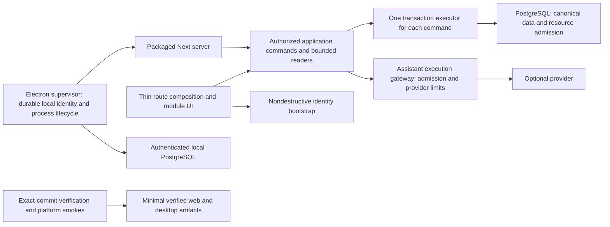

**Omplish architecture investigation — issues and countermeasures**

Audit date: 16 October 2026, Asia/Kuching. Source baseline: commit `6cd5272ddde074ea2d23c5893981fc6c0dfb13db`, package version `0.1.1`; tracked working tree was clean when investigation began. This is a research report, not an implementation authorization or release sign-off. Recommendations do not promote later-scope features into the active release.

**Recommendation: retain the modular monolith, Next.js, and PostgreSQL. Repair lifecycle and transaction boundaries first, then reduce unnecessary work and packaging overhead.** The present problem is uneven enforcement of otherwise useful contracts, especially around profile bootstrap, Companion, desktop operation, and release automation. A framework or database rewrite would carry those defects into a larger migration.

The first action should be to separate nondestructive workspace bootstrap from demo reset and add a regression that preserves a real task through startup failure/retry. In parallel, triage and remediate the current dependency audit failure before distributing another candidate.

**Evidence and limits**

Four audit tracks inspected application architecture, security, data/query behavior, and desktop/deployment operation. Repository contracts, implementation, tests, installed dependency source, and primary upstream documentation were compared. Relevant Next.js guidance was also checked against the documentation bundled with installed Next `16.2.10`; current online documentation can describe newer versions.

“Verified” below means the implementation/configuration or command result was directly inspected. A source-confirmed failure path is distinguished from an incident reproduced against a running application. Load, exploitation, native restart, and restoration outcomes are not claimed without running them.

| Check actually run | Result |
| --- | --- |
| `pnpm format:check` | Passed before adding this report; the report receives its own formatting check |
| `pnpm lint` | Passed |
| `pnpm typecheck` | Passed, including Node and Electron configurations |
| `pnpm test:boundaries` | Passed: 124 intentionally invalid probe violations were rejected; these are not 124 violations in product code |
| `pnpm test` | 144 files, 692 tests passed; reported duration 19.65 seconds |
| `pnpm audit --prod --audit-level high --fetch-retries 0` | **Failed, exit 1:** 44 advisories: 3 critical, 15 high, 22 moderate, 4 low |
| `pnpm audit --prod --json --fetch-retries 0` | Retrieved structured advisory evidence; exit 1 reflects findings |

The advisory request initially failed under restricted network access; an approved read-only registry request succeeded. Counts above come from that successful request. Agents additionally ran focused subsets of existing unit tests; those passes overlap the full suite and are not additional coverage.

Not run: fresh production build, database integration/concurrency tests, destructive reset reproduction, browser E2E/accessibility/visual checks, realistic load tests, native installers, Docker production smoke, backup restore, live OpenAI calls, or deployed-system checks. No application/schema/dependency change was made. Consequently, the full `pnpm verify` gate is not passed, and its dependency audit component currently fails.

**Current architecture and size**

The implemented product is one TypeScript application with feature-owned application/domain/infrastructure/presentation layers. Next serves the web application; PostgreSQL owns state; Electron packages the same server and a per-user PostgreSQL process. The worker is currently a zero-job baseline. Recurrence, habits, Focus, PWA, and reminders are release commitments, not implemented systems whose performance was measured here. See [architecture](../ARCHITECTURE.md), [scope](../SCOPE.md), and [module routing](../MANIFEST.md).

| Observation | Measured result | Interpretation |
| --- | --- | --- |
| Tracked files | 907 | Includes documents, migrations, tests, and assets |
| Source inventory | 488 production-like TS/TSX/CTS/MJS files, 42,332 lines | Under `app`, `modules`, `shared`, `electron`, `worker`, `scripts`; excludes test/spec and filename-labelled fixture/support files |
| Oversized source files | 4 over 300 lines; 2 over 400 | No evidence of a repository-wide large-file problem |
| Largest UI files | `OnboardingFlow.tsx`: 565 lines; `AmethCompanion.tsx`: 432 | Target these responsibility boundaries before blanket refactoring |
| Largest feature | Tasks: 153 production-like files, 17,920 lines | Size is concentrated in the feature with the broadest behavior and established tests |
| Existing local directories, rounded disk use | `.next`: 3.7 GiB; `node_modules`: 1.1 GiB; `release`: 1.5 GiB; `desktop`: 763 MiB | Existing mixed build/runtime artifacts; not fresh-build sizes, installer sizes, browser transfer, or RAM usage |
| Historical macOS arm64 installer | `Omplish-0.1.1-macOS-arm64.dmg`: 227 MiB | July 2026 artifact; not rebuilt or signature/provenance-verified in this audit |
| Historical Windows artifacts | `OpenTask-0.0.0-Windows-x64.exe`: 176 MiB; unpacked tree: 629 MiB | Older name/version; useful only to locate size contributors, not certify the current release |
| Existing selected arm64 runtime staging | 268 MiB; Node executable alone: 113.6 MiB logical size | PostgreSQL binaries inspected in this tree include universal x86_64/arm64 binaries; target thinning is a candidate to validate before signing |

The directory measurements establish where to inspect, not an optimization baseline. In particular, the Docker context excludes local `.next`, so the local 3.7 GiB figure must not be presented as the container's build output. No percentage reduction or supported concurrent-user count is justified by these observations.

Preserve the strongest parts: tenant-leading composite keys and ownership predicates, canonical task/schedule facts, core keyset pagination, finite planning ranges/truncation, optimistic versions, atomic reviewed planner apply, private snapshot-consistent export, strict request schemas, bounded bodies, safe logging, and executable import-boundary rules. These provide more value than reducing the number of folders.

**Prioritized findings**

Priority is remediation urgency, not the repository's P0–P8 work-package numbering. “Blocker” means resolve before distributing the affected candidate. Conditional security findings state their deployment assumptions.

| ID | Priority | Current issue | Main countermeasure | Dimensions |
| --- | --- | --- | --- | --- |
| A01 | Blocker | Normal bootstrap retry can reset task data | Separate ensure/resume from explicit demo reset | Reliability, integrity |
| A02 | Blocker for affected distribution | Pinned dependency graph fails security audit | Patch and verify actual shipped dependencies | Security, maintainability |
| A03 | High | Session loss leaves no route back to the original actor | Durable identity and explicit recovery semantics | Reliability, security |
| A04 | High | Transactions acquire another pooled connection | Preserve one transaction executor across module calls | Reliability, scalability |
| A05 | High on shared OS | Desktop PostgreSQL trusts any reachable local client | Authenticated, least-privilege local database access | Security |
| A06 | High on public hosted AI | Unbounded aggregate provider work/spend | Central admission, concurrency and resource limits | Security, reliability, cost |
| A07 | High | Memory quota races under concurrent writes | Serialize per-user quota read/eviction/write | Integrity, scalability |
| A08 | High | CI/runtime release paths do not enforce the same gates | Repair image/staging defects; gate exact release commit | Reliability, maintainability |
| A09 | High before desktop release | Child processes are monitored only during startup | Supervise runtime failure and controlled recovery | Reliability |
| A10 | Medium | Companion polls and loads unnecessary history | Separate small state/authorization reads from detail | Performance, scalability |
| A11 | Medium | Prompt Library loads all content at once | Summary pagination and detail reads | Performance, size |
| A12 | Medium | Rank writes scan whole retained sibling scopes | Neighbor queries and bounded-window rebalance | Performance, scalability |
| A13 | Medium | Export buffers the entire dataset and has no admission limit | Measure/admit exports; preserve one consistent snapshot | Reliability, scalability |
| A14 | Medium | New UI bypasses established request/recovery patterns | Typed clients, pending/offline/conflict recovery | Maintainability, reliability |
| A15 | Medium | Docker packaging duplicates deployment strategies | Trace/minimize runtime contents and build context | Size, security, operations |
| A16 | Medium | Frontend loading/search lack measured budgets | Analyze route imports, defer optional UI, cancel reads | Size, performance |
| A17 | Medium | Key lifecycle and obsolete auth routes drift from contracts | Dedicated encryption lifecycle; narrow public auth surface | Security, maintainability |
| A18 | Medium | Tests and performance evidence miss composition faults | Public-runtime DB tests and representative benchmarks | Reliability, maintainability |

**A01 — Bootstrap and destructive demo reset share a code path.**

Verified source chain: [ProfileSetupLauncher](../../modules/identity/presentation/ProfileSetupLauncher.tsx#L38) defaults `existingProfile` to false. Initial returning-profile reads use true, but the error button calls `openWorkspace(activeUsername)` at line 108 without it. A transient onboarding/settings read failure followed by Retry therefore calls `/api/v1/demo`. For a valid demo actor, [identity application](../../modules/identity/application/identity-application.ts#L198) invokes `resetDemoWorkspace`; [task dataset replacement](../../modules/tasks/infrastructure/demo-dataset-repository.ts#L85) hard-deletes tasks, schedules, checklist items, sections, regular lists, folders, and tags before reseeding. Preferences are reset too. These are the same demo actors used by ordinary profile launch.

Desktop adds a second trigger: [runtime startup](../../electron/runtime.ts#L38) chooses a fresh port, but the username is in origin-scoped [localStorage](../../modules/identity/presentation/profile-storage.ts#L1). A changed port can remove the visible username while the host cookie remains valid. Re-entering a name then reaches the same reset path. This is a conditional code-confirmed defect, not a native data-loss reproduction. The distinction between port-scoped storage and cookies is documented by [MDN](https://developer.mozilla.org/en-US/docs/Web/Security/Defenses/Same-origin_policy) and [RFC 6265](https://httpwg.org/specs/rfc6265.html#section-8.5).

Countermeasure: give identity three explicit operations: ensure/resume workspace, create an isolated demo, and explicitly reset a demo. A read retry must never invoke a destructive operation. Prefer authoritative server/session state over a display-name cache. Test a custom task through failed GET/retry, missing localStorage, changed desktop port, and restart; assert stable record IDs and content. Stabilizing the port alone does not fix retry or cookie-loss behavior.

**A02 — The production dependency audit currently fails.**

`package.json` pins Next `16.2.10`. The successful registry audit reports 44 advisories, including these three critical Next entries. Version matching is verified; exploitability depends on the feature and deployment.

| Upstream advisory | Audit-reported patched version | Applicability to this checkout |
| --- | --- | --- |
| [Windows-hosted Next RCE](https://github.com/vercel/next.js/security/advisories/GHSA-p293-qw3h-jr36) | Next `16.3.3` | Windows desktop is an intended target using a local Next server; the relevant platform exists in the design. Loopback reduces exposure but does not patch the vulnerable server. No exploit attempted |
| [AVIF image optimization RCE](https://github.com/vercel/next.js/security/advisories/GHSA-2xp9-vwfh-vxw4) | Next `16.3.3` | Vulnerable package version present; no attacker-controlled AVIF input path established in this audit |
| [Node `next/og` ImageResponse RCE](https://github.com/vercel/next.js/security/advisories/GHSA-vcvr-r3jv-pc5j) | Next `16.3.6` | No `next/og`/`ImageResponse` usage found in application source; package match does not establish a reachable feature |

The 15 high findings include Next, Sharp, Undici, Nano ID, Browserslist, and source-map-js. A later [Next image-optimization SSRF advisory](https://github.com/vercel/next.js/security/advisories/GHSA-cjq9-62q9-8jv4) reports a `16.3.8` fix, so upgrading only to `16.3.3` would not address every reported Next finding. Audit paths include optional peers such as `better-auth > vitest > jsdom > undici`; inspect the actual container and desktop dependency trees before asserting that every listed package executes in production.

Countermeasure: choose a supported, patched Next release covering all applicable advisories, align `eslint-config-next`, review its upgrade notes, regenerate the lockfile, then rerun the complete web and desktop gates. Resolve transitive findings through compatible upstream updates or narrowly justified overrides; do not blindly run a force-upgrade command. Record exceptions only with feature-reachability evidence. Audit Electron, bundled Node/PostgreSQL, OS/image packages, and release binaries separately: `pnpm audit --prod` does not cover those surfaces. Pinning improves reproducibility but requires a scheduled patch review.

**A03 — Profile continuity depends on a disposable session.**

[Demo authentication](../../modules/identity/infrastructure/authentication-gateway.ts#L153) generates random credentials and returns a cookie, without retaining a user-usable recovery credential. The configured Better Auth instance does not override session lifetime. Installed Better Auth defaults to seven-day expiry with a one-day refresh age; see its `dist/context/create-context.mjs` and [session documentation](https://better-auth.com/docs/concepts/session-management). Session loss after inactivity or cookie deletion is established. Active-use continuity is also at risk: `findSession()` calls `auth.api.getSession({ headers })` without forwarding refreshed response cookies, and no separate browser refresh or Next cookie integration was found. Database session renewal alone does not renew the browser cookie.

After loss of the session, the launcher falls through to account creation, generating a different actor. Old records remain in PostgreSQL but are unavailable through the product. A local display name cannot safely authenticate ownership.

Countermeasure: define durable local identity separately from expiring web sessions and propagate cookie renewal through a response boundary that can actually set cookies; see [Better Auth's Next integration](https://better-auth.com/docs/integrations/next). For Electron, use an OS-user-protected capability with a narrow trusted bootstrap operation that reissues a session for the same actor. For hosted browser use, explicitly choose supported recovery semantics; adding a new recovery product surface requires the scope/contract process. A longer cookie postpones the defect. Test database expiry and browser-cookie renewal together, plus cleared cookies, upgrades, and hostile attempts to recover another user's actor. Keep manual startup independent of AI credential health.

**A04 — Transaction composition can exhaust the connection pool.**

[Task completion](../../modules/tasks/application/task-application.ts#L230), planner Apply, and check-in hold a transaction while awarding XP. [The public XP wrapper](../../modules/companion/application/public.ts#L26) first calls `localDateForActor()`, which invokes identity preferences using the global database rather than the supplied transaction. [The pool](../../shared/db/client.ts#L11) is limited to ten and has no explicit acquisition deadline.

If all ten connections are held by transactions that each wait for another pooled read, those operations cannot finish and release their original connections. This is a resource-wait risk established by the call chain, not a measured load incident. Increasing pool size merely moves the trigger. Memory writes contain a similar leak in A07. Node-postgres requires all operations in a transaction to use its [same client](https://node-postgres.com/features/transactions); exhausted requests wait in the [pool queue](https://node-postgres.com/apis/pool).

Countermeasure: make transaction ownership explicit across public module contracts. Pass the already-authoritative local date/context or a transaction-aware narrow reader. Require a transaction for XP effects coupled to source mutations; standalone entry points should start their own transaction explicitly. Add acquisition, statement, lock, and idle-transaction deadlines as containment, using [PostgreSQL timeout controls](https://www.postgresql.org/docs/18/runtime-config-client.html). Verify public-runtime composition with pool size one, then synchronized multi-user writes above pool capacity, including rollback and idempotency.

**A05 — Desktop PostgreSQL uses trust authentication.**

[Runtime initialization](../../electron/runtime.ts#L113) passes `--auth=trust`; PostgreSQL listens on `127.0.0.1` and the app connects as the initialization role without a password. Loopback is not an OS-user access boundary: another local account/process able to reach the port can connect as that database role. PostgreSQL explicitly warns that [trust authentication permits anyone who can connect to claim a database user](https://www.postgresql.org/docs/current/auth-trust.html). This is a local threat; it is not evidence of internet-exposed PostgreSQL.

Countermeasure: initialize unique local credentials, require SCRAM for loopback connections, restrict OS permissions/ACLs on data and secrets, and run normal application traffic with a non-superuser role distinct from migration/bootstrap privileges. Unix sockets with verified peer/permission semantics can be considered on macOS, but Windows needs an explicit supported equivalent. Provide an upgrade path for already-created trust clusters. Test unauthenticated and second-OS-user access denial, startup, migrations, backup restoration, and absence of secrets in logs/arguments.

**A06 — Optional AI has no aggregate resource admission control.**

[Credential resolution](../../modules/assistant/infrastructure/openai-credential-config.ts#L22) falls back to the server API key for any actor without a personal key. Public bootstrap creates actors; planner/chat/analysis routes validate and authorize, but no corresponding application rate/concurrency/budget boundary was found. Existing provider timeouts and token limits bound one call, not total parallel requests or spend. This is high priority for a publicly reachable instance with a shared server key; a single-user loopback instance has a different exposure.

Countermeasure: put admission in one assistant-owned execution gateway used by every paid/provider operation. Use authoritative per-instance and per-actor resource limits, bounded concurrency and input/output limits, safe 429 responses, and cancellation/slot cleanup. Instance limits must survive actor rotation and multi-process operation. PostgreSQL is sufficient initially. These are abuse controls, not a new billing or premium-quota feature. The problem matches [OWASP unrestricted resource consumption](https://api-security.owasp.org/editions/2023/en/0xa4-unrestricted-resource-consumption/). Verify rejection invokes the provider zero times, concurrency across actors/instances stays bounded, and provider outages preserve manual paths.

**A07 — The promised memory cap is not atomic.**

[Memory save](../../modules/companion/application/companion-application.ts#L185) opens a transaction, reads all cards through a global-pool method, calculates bytes in JavaScript, then evicts/inserts in the transaction. Concurrent near-cap saves can both observe available space and both commit above 30 MiB. This also amplifies A04. The UI ignores the returned eviction count at [AmethCompanion line 159](../../modules/companion/presentation/AmethCompanion.tsx#L150), so automatic eviction lacks event-specific feedback.

Countermeasure: acquire a consistent per-user transaction-scoped advisory lock or existing row lock, then perform quota read, eviction, and insertion on the same executor. Use SQL `octet_length(text)` for aggregation and bounded oldest-first eviction batches; preserve deterministic ordering for timestamp ties. Coordinate delete/reset lock ordering. Report actual eviction to the user. [PostgreSQL locking documentation](https://www.postgresql.org/docs/18/explicit-locking.html) supports this serialization approach. Test concurrent saves, multibyte text, rollback, isolation, and visible eviction results.

**A08 — Release automation is disconnected from its verification contract.**

Three concrete defects/gaps are visible:

- [CI line 54](../../.github/workflows/ci.yml#L54) builds `opentask:local`, but [Compose](../../compose.yaml#L23) requires `omplish:local` and CI starts it with `--no-build`. A clean runner cannot use the image it just built under that different name.
- [Runtime staging](../../scripts/stage-desktop-runtime.mjs#L168) checks a native `path.resolve()` result against a prefix ending with a literal `/`. On Windows, normal descendant paths use backslashes and are rejected. Fix with `path.relative`/`isAbsolute` plus traversal/symlink checks, not by weakening the safety guard.
- [Desktop publishing](../../.github/workflows/publish-desktop.yml#L3) runs on main/master pushes; its publish job depends only on the two build jobs, not canonical verification. It publishes an explicitly unsigned public prerelease. Package/runtime smoke exists, but it does not prove the real profile flow, task survival, native GUI, signed distribution, or the documented Intel Mac target.

Countermeasure: make artifact publication consume the exact commit/artifacts that passed canonical verification and platform-specific package tests. Repair image naming and Windows staging first. Distinguish CI artifacts, deliberately approved unsigned test builds, and signed/notarized distribution. Exercise the actual profile workflow rather than a different account API in runtime smoke. Add path tests with both `path.win32` and `path.posix`, then run real Windows/macOS clean-install, restart, upgrade, and shutdown tests. Existing workflow configuration was inspected; no claim is made about its remote run history.

**A09 — Desktop supervision ends when startup succeeds.**

[Runtime](../../electron/runtime.ts#L50) waits for readiness and returns a stop function. [Process helpers](../../electron/runtime-process.ts#L6) remove startup error listeners after readiness; no persistent recovery policy for a later Next/PostgreSQL exit is installed by this composition. PostgreSQL output is ignored. The window can therefore remain open after its backend dies without a useful runtime recovery path. Port discovery also closes its temporary listener before the child binds, leaving a race to handle. PostgreSQL starts before the guarded cleanup block, so a subsequent environment/secret preparation failure can leave it running; command execution also lacks a deadline for migrations and other subprocess commands.

Countermeasure: own a small explicit runtime state machine (`starting`, `ready`, `degraded`, `stopping`, `failed`) in Electron. Establish cleanup ownership immediately after the first child starts, propagate quit cancellation, and bound subprocess execution time. Monitor child exit/error for their lifetime, keep bounded redacted diagnostics, surface a local recovery action, and stop dependents in order. Use bounded retries for address-in-use/startup failures. Do not repeatedly restart a database after migration/storage corruption; preserve the directory and present recovery instructions. Test child termination after readiness, occupied ports, failed/hung migration, secret permission failure, disk-full behavior, and quit during startup. Follow [Node's child-process lifecycle](https://nodejs.org/api/child_process.html#event-exit) with idempotent cleanup. Electron remains a process supervisor, not a second domain implementation.

**A10 — Companion background work scales with retained history.**

[State loading](../../modules/companion/application/companion-application.ts#L73) fetches all memory cards then slices twenty; chat loads the complete set again. At the nominal cap, a state request may move roughly 30 MiB of memory text from PostgreSQL into Node despite returning a small subset. [The global widget](../../modules/companion/presentation/AmethCompanion.tsx#L77) calls this every twenty seconds while visible, even with the drawer closed. That is 180 calls per visible hour per mounted tab, before initial/refetch activity. This is arithmetic from the interval, not measured traffic.

[Prompt authorization](../../modules/prompts/application/prompt-application.ts#L31) calls the entire Companion state reader just to check level. Summary rebuild reads all XP events and aggregates in JavaScript; its `windowStartedOn` uses the strongest day although counts include all events.

Countermeasure: expose a narrow level/unlock reader; split small avatar state from memories/summary detail; fetch twenty cards in SQL with `(created_at,id)` ordering and reuse them in chat. Prefer mutation invalidation plus bounded freshness/visibility behavior over unconditional full-state polling. Aggregate summary statistics in SQL and make the observation-window metadata truthful. Preserve existing behavior and avoid introducing analytics services or new projection tables. Verify bounded rows/bytes, query counts, ordering, and heap growth using near-cap fixtures.

**A11 — Prompt Library has no bounded list contract.**

[The repository](../../modules/prompts/infrastructure/prompt-repository.ts#L11) selects every matching prompt including content, then application code loads tags for all IDs. Prompt content permits 20,000 characters. A thousand maximum-length ASCII prompts therefore contain roughly 20 MB of content before JSON/React overhead; this illustrates growth, not an observed dataset. Timestamp-only ordering also lacks a stable pagination tie-breaker.

Countermeasure: return cursor-paginated summary DTOs ordered by `(updated_at DESC,id DESC)` and fetch content only when needed. Reuse the existing task pagination approach, preserve owner constraints and offline/manual states, and review an index against actual query plans. [Drizzle's cursor-pagination guidance](https://orm.drizzle.team/docs/guides/cursor-based-pagination) covers composite ordering. Test tied timestamps, concurrent changes, archived filtering, tenant denial, and bounded payloads at 100/1,000/10,000 records.

**A12 — Fractional ranks do not currently bound ordinary write cost.**

[Rank preparation](../../modules/tasks/application/task-application-support.ts#L72) loads all siblings under its scope lock; [the query](../../modules/tasks/infrastructure/task-repository-queries.ts#L116) includes retained completed/cancelled rows because it filters deletion, not status. [Placement](../../modules/tasks/application/ranked-placement.ts#L28) copies and sorts that whole scope. Rebalance performs many sequential updates; above the documented 500-row rebalance bound, repeated insertions into a narrow gap can keep growing toward the stored key ceiling.

Countermeasure: under the existing lock, load only requested anchors and predecessor/successor or boundary ranks for ordinary placement. Design bounded neighboring-window rebalance and batch checked updates while retaining version/collation/restore semantics. Do not silently drop terminal tasks from the ordering model. Benchmark 1k/10k/100k retained siblings and repeatedly insert into the same gap. Preserve the existing deterministic and concurrency tests.

**A13 — Export is snapshot-consistent but memory-proportional to all data.**

[Export application](../../modules/portability/application/export-application.ts#L40) loads every module's portable rows in one read-only Repeatable Read transaction, maps/validates the full envelope, and [the route](../../app/api/v1/export/route.ts#L15) creates a complete JSON string. Multiple object/string representations and concurrent requests can amplify heap usage and connection occupancy. Expired planner proposals remain exportable rows; expiry currently limits applicability rather than storage retention.

Countermeasure: first add bounded concurrent exports, cancellation, and row/byte/heap/duration measurements with an explicit supported envelope. If larger datasets require incremental serialization, preserve one consistent snapshot and relationship/schema validation; do not independently page each module in separate transactions. Disk spooling changes the current no-server-storage contract and requires explicit design/privacy review. Any proposal cleanup policy must preserve applied idempotency evidence and existing user-data commitments. A JSON export is not a tested disaster-recovery restore path. Test concurrent mutation during export, large envelopes, cancellation, and secret exclusion.

**A14 — Companion and Prompt UI do not reuse the core's recovery discipline.**

[Ameth mutations](../../modules/companion/presentation/AmethCompanion.tsx#L106) and [Prompt operations](../../modules/prompts/presentation/PromptLibrary.tsx#L26) use raw fetch, locally duplicated response types, and incomplete pending/network/conflict handling. Rejected network promises can escape; several non-OK responses are ignored. Overlapping submissions are not consistently prevented, and stale-version recovery is weaker than the task editor's typed transport/mutation behavior. This is directly visible in code; no visual defect sweep was run.

Countermeasure: use module-owned typed API clients and behavior hooks on the already-approved TanStack Query foundation. Preserve user drafts; handle pending, offline, permission, network, validation and conflict states explicitly; prevent duplicate submissions; make retry semantics safe. Share only genuinely generic transport mechanics, not feature rules. Split the 432-line Companion into widget state, drawer interaction, and memory/settings responsibilities; split the 565-line onboarding flow around its state transitions. Do not add a state-management framework or split files solely to satisfy a line count.

**A15 — Docker packages both a full dependency installation and standalone output.**

[Next config](../../next.config.ts#L50) enables `output: "standalone"`, but [Docker runner](../../Dockerfile#L23) installs/copies all production dependencies, copies the complete builder `.next`, and starts `next start`. This carries traced standalone output alongside the full-tree deployment and can retain builder cache output. [.dockerignore](../../.dockerignore) excludes local `.next` but does not exclude `release`, staged desktop runtimes, or desktop build output, so local desktop artifacts can also bloat build context/builder layers.

Countermeasure: select one deployment layout. Prefer a minimal standalone web image with the required static/public assets; create explicit, small runtime targets for migrations and the worker if their dependencies are not traced into the web server. This is packaging separation within one repository, not a microservice redesign. Alternatively retain `next start` and remove unused standalone/cache output. Verify all trace exclusions using production startup/migration/job smoke, not file-size guesses. Next documents the [standalone output boundary](https://nextjs.org/docs/app/api-reference/config/next-config-js/output).

Keep licenses and required native libraries. Record per-platform compressed installer size, installed size, process RSS and startup time separately. Inspect the PostgreSQL executable/shared-library dependency closure before removing utilities, locales or architectures; validate initialization, migrations and recovery after any trimming. Removing Electron, bundled Node or PostgreSQL simply to reach a smaller installer changes the approved desktop architecture and introduces migration/platform work; it is not the first optimization.

**A16 — Frontend optimization needs route evidence and cancellation.**

[FullCalendarView](../../modules/planning/presentation/FullCalendarView.tsx#L3) statically imports four calendar plugins; [CalendarScreen](../../modules/planning/presentation/CalendarScreen.tsx#L7) loads that component eagerly. The command palette and Companion are composed into every authenticated screen. This identifies candidates for deferred optional UI, not proof that all calendar code downloads on every route: barrels and client-reference manifests alone cannot establish actual browser transfer.

Search changes flow directly from [palette input](../../modules/tasks/presentation/TaskCommandPalette.tsx#L70) into [query keys](../../modules/tasks/presentation/data/use-task-queries.ts#L61), with no debounce or forwarded query abort signal. Rapid typing can therefore start requests for intermediate strings. Query keys protect result identity, but abandoned network/SQL work still costs resources.

Countermeasure: produce a fresh route-level bundle/import graph using Next's built-in analyzer for the Turbopack web build and an appropriate Webpack analysis for desktop. Defer drawer/editor bodies and optional heavy UI from a Client Component boundary; preserve immediate keyboard triggers, accessible loading and navigation. Lazy loading is documented by [Next](https://nextjs.org/docs/app/guides/lazy-loading); the installed version also includes [bundle analysis](https://nextjs.org/docs/app/guides/package-bundling). Add a short measured search debounce and propagate `AbortSignal` through read clients. Do not treat cancellation as permission to retry non-idempotent mutations. Measure transfer, parse/execute time, interaction latency and request counts before claiming a gain.

**A17 — Security configuration has lifecycle and contract drift.**

Three smaller issues warrant focused repairs after the blockers:

- [Public auth routing](../../modules/identity/infrastructure/authentication-request-contract.ts#L22) still exposes email signup/signin/signout, although the identity module contract excludes those product entry paths. Close unsupported public routes while retaining necessary internal Better Auth bootstrap APIs. Update smoke tests that rely on obsolete public signup.
- [Credential encryption](../../modules/assistant/infrastructure/openai-credential-config.ts#L14) falls back from a dedicated key to the auth secret, then to a known development constant. Properly configured production avoids the constant. Changing the dedicated encryption key, or rotating the auth secret while it serves as the encryption fallback, makes existing credentials unreadable unless re-encrypted or the previous key remains available. Generate/require dedicated unique key material whenever storing personal keys, introduce key identification and re-encryption, and return a recoverable reconnect state. Keep AES-GCM. See [OWASP key-management guidance](https://cheatsheetseries.owasp.org/cheatsheets/Cryptographic_Storage_Cheat_Sheet.html).
- [Production CSP](../../next.config.ts#L25) permits inline scripts. No user-input XSS was found; Markdown is not configured to render raw HTML. Introduce nonces on appropriate dynamic routes as defense in depth, preserving theme boot and desktop behavior. [Next's CSP guide](https://nextjs.org/docs/app/guides/content-security-policy) explains the rendering tradeoffs.

[Saving an API key](../../modules/assistant/application/openai-settings.ts#L45) also performs two sequential verification requests. One bounded verification plus normal later-error handling avoids redundant latency without pretending provider validity and local persistence can be one atomic transaction.

**A18 — Green checks do not yet cover the most important new compositions.**

The 692-test unit pass is useful. However, no dedicated Companion/Prompt behavior or database integration suites were found; export tests contain minimal mocks for their data. Existing runtime smoke creates an ordinary email/password account rather than reproducing the profile bootstrap that users actually take. These gaps leave transaction leakage, quota races and startup resets untested.

The [planning query-plan test](../../tests/db/planning-query-plan.test.ts#L139) disables sequential scans, and [search plan tests](../../tests/db/wp02-schema-search.test.ts#L54) alter scan settings. Those tests protect index eligibility; they do not demonstrate default-planner latency or production scale. Keep them and add representative `EXPLAIN (ANALYZE, BUFFERS)` measurements as described by [PostgreSQL](https://www.postgresql.org/docs/18/using-explain.html).

Countermeasure: prioritize real-database tests through public runtime composition, not only application factories. Add process-failure/restart and data-survival desktop scenarios. Define local performance fixtures and budgets; record cold/warm behavior, p50/p95, errors, Node heap, event-loop lag, SQL rows/buffers and pool waiting. Use content-free first-party diagnostics and the existing structured logger. Build a reproducible restore drill with protected database and key material; the documented manual desktop backup instructions are a starting point, not evidence that restoration works. Reject unsupported PostgreSQL major-version transitions before opening an existing data directory, and document a supported upgrade procedure. Operator backup/recovery is distinct from the later-scope product import feature. See PostgreSQL's [filesystem backup](https://www.postgresql.org/docs/17/backup-file.html) and [major upgrade](https://www.postgresql.org/docs/17/upgrading.html) guidance.

**Proposed target boundaries**

The diagram describes recommended repairs, not components already implemented.

Keep feature policies in their owning modules. Do not introduce a generic repository/service framework, DI container, event bus, Redis, or microservices to repair these issues. A narrowly injected transaction/context contract is sufficient. Companion's optional provider must remain optional even while XP effects retain their required transactional semantics.

**Sequence and verification checkpoints**

Effort estimates below are planning judgments in focused engineering days, not commitments. They overlap and exclude waiting for signing credentials, platform access, or visual approval.

| Order | Work | Indicative effort | Exit evidence |
| --- | --- | --- | --- |
| 1 | A01 destructive bootstrap; A02 dependency triage/update | 2–4 days | Data-survival regression, applicable advisory fixes, full required gates on patched artifacts |
| 2 | A03 identity continuity; A05 local DB security; A08 release defects | 3–6 days | Same actor after expiry/restart, local unauthorized DB access denied, native staging and correct CI artifacts |
| 3 | A04 transaction ownership; A07 memory atomicity; Companion/Prompt DB tests | 2–4 days | Pool-size-one public commands, parallel quota writes, rollback and cross-user denial |
| 4 | A06 provider admission; A09 runtime recovery | 2–4 days | Mocked admission limits, provider absence, post-readiness child failure and safe restart |
| 5 | A10–A12 bounded reads/ranks; A14 UI recovery | 3–6 days | Bounded SQL/payload work, safe conflicts/offline drafts, affected browser/accessibility/design gates |
| 6 | A13 export growth; A15–A17 packaging/performance/hardening; broader A18 benchmarks/restore evidence | 3–6 days | Before/after artifacts and benchmarks, consistent exports, restore evidence, approved security exceptions only |

Start with the smallest regression-backed patches. A18's targeted regression/composition tests accompany each repair above; they are not deferred to the final measurement phase. Do not combine bootstrap repair, dependency upgrades, database security, UI restructuring and query optimization into one review. Scope changes such as a hosted account-recovery feature must follow `docs/SCOPE.md`; shared UI changes remain subject to the existing visual/design gates. This report does not waive them.

**Performance and scale criteria to establish**

These are proposed acceptance criteria, not observed product performance:

| Area | Proposed measurement or invariant |
| --- | --- |
| UI interaction | Target p75 LCP ≤2.5 s, INP ≤200 ms, CLS ≤0.1, segmented by device; use representative local interaction measurements before collecting any approved first-party field data |
| Database commands | Pool-size-one correctness; no second connection required inside a command transaction; bounded failure deadlines |
| Ordinary reads | Explicit finite page/range/byte bounds; small authorization queries independent of content history |
| Companion | At most twenty memory records fetched for recent context; SQL byte accounting; no overlapping full-state poll loop |
| Ranking | Ordinary placement reads a bounded neighbor set regardless of retained task count |
| Export | Consistent snapshot, initially one admitted export per actor plus a small global process/instance concurrency bound, measured heap envelope and cancellation deadline; exact limits chosen from benchmarks |
| Packages | Record compressed and installed size, dependency inventory, cold-start p50/p95 and steady/peak process RSS per OS/architecture |
| Recovery | Same user/task IDs survive retry/restart/upgrade; demonstrated restore from backup plus matching secrets |

The UI thresholds come from [Google's Web Vitals guidance](https://web.dev/articles/vitals); lab measurements are not a claim of field compliance. Establish fixture hardware, dataset distributions and concurrency before choosing API p95 or RSS limits. Report no invented user-capacity figure.

For hosted scaling, first fix per-request work and transaction waits. Then budget total connections across web replicas, migrations and the future worker: `replicas × pool size + operational reserve` must fit the PostgreSQL connection envelope. Increase application replicas only when measured CPU/latency warrants it; consider connection pooling only after validating transaction/advisory-lock behavior. Configure a reverse proxy with request limits/timeouts and trusted forwarded headers. The [Next self-hosting guide](https://nextjs.org/docs/app/guides/self-hosting) documents proxy and multi-instance concerns. Avoid introducing shared authenticated caches merely to reduce latency; ownership and freshness must remain explicit.

Before any multi-replica or overlapping deployment, serialize migrations. [Compose](../../compose.yaml#L31) currently invokes migrations in each web startup; [the migration script](../../scripts/migrate.ts#L12) has no explicit cross-process lock. Use a single deployment migrator with a transaction/session-appropriate advisory lock and deadline. [Readiness](../../shared/health/database-readiness.ts#L20) requires an exact migration revision, so old/new binary overlap also needs a reviewed compatibility strategy and expand/contract migrations where necessary. These are scale prerequisites, not claims of an observed single-instance outage.

**Alternatives considered**

| Option | Assessment |
| --- | --- |
| Optimize the existing modular monolith | **Recommended.** Preserves tested authorization, transactions, time semantics and one codebase; directly addresses the observed defects |
| SQLite/PGlite desktop persistence | Could change the runtime footprint, but requires a reviewed compatibility/migration assessment for PostgreSQL-specific SQL, locks, constraints and pg-boss. This is outside a narrow optimization patch and is not recommended before the current release is reliable |
| Tauri/native shell | Requires platform/runtime/security and packaging work while Next/PostgreSQL still need a hosting solution. No measured requirement presently justifies the migration |
| Microservices/Redis/event bus | Adds deployment, failure and consistency boundaries without fixing the identified local transaction/query faults; poor fit for current solo maintenance |
| Broad dependency removal or file consolidation | Unmeasured savings can sacrifice mature functionality and useful boundaries. Remove only unused or demonstrably costly runtime contents/imports after artifact analysis |

The core architecture is suitable for continued development. Its immediate release risks are data continuity, dependency maintenance, cross-module transaction ownership and operational gates. Optimizing those boundaries will improve reliability and security first, while bounded queries and deliberate packaging provide the clearest path to better performance and size.
